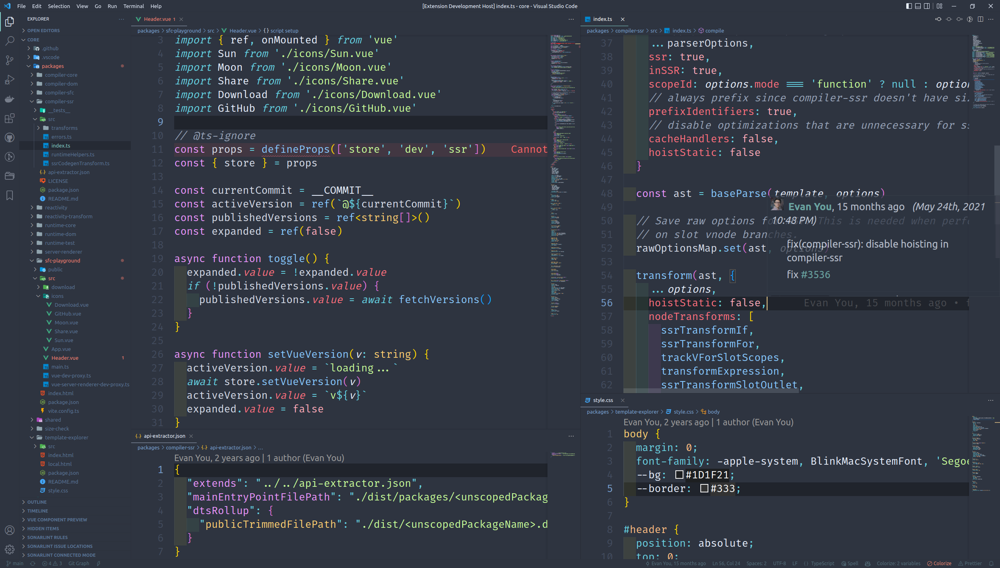

# Gems theme 

[Gems Theme](https://marketplace.visualstudio.com/items?itemName=Mikaleb.gems-theme) is a VSCode theme that is based on [Material Theme](https://github.com/material-theme/vsc-material-theme) with theming inspiration from [Nord](https://www.nordtheme.com/) and [Plastic Theme](https://plastictheme.com/) designed to be easy on the eye and easy to use.

[](https://vscode.dev/theme/mikaleb.gems-theme/Gems)
[](https://marketplace.visualstudio.com/items?itemName=Mikaleb.gems-theme)
[](https://github.com/prettier/prettier)
[](https://github.com/Mikaleb/Gems-Theme/blob/main/LICENSE.md)
[](CODE_OF_CONDUCT.md)

## Screenshot



## Installation

0. With _Quick Open_ : `ext install Mikaleb.gems-theme `

1. Or : Open **Extensions** sidebar panel in VS Code ( `View → Extensions` )
2. Search for `Gems Theme` - find the one by **Mikaleb**
3. Click **Install** to install it
4. Code > Preferences > Color Theme > **Gems**
5. Recommended font : _Fira Code_

## Contribution

If you run into a bug or miss a feature, please [open an issue](https://github.com/Mikaleb/Gems-Theme/issues) in this repository.

### Launch project locally

```bash
yarn
yarn build
```

By pressing F5 in VSCode you should be able to have a new window with the theme. If not, create the file `.vscode/launch.json` with this :

```json
{
  "version": "0.2.0",
  "configurations": [
    {
      "name": "Extension",
      "type": "extensionHost",
      "request": "launch",
      "runtimeExecutable": "${execPath}",
      "args": ["--extensionDevelopmentPath=${workspaceFolder}"]
    },
    {
      "name": "Extension Tests",
      "type": "extensionHost",
      "request": "launch",
      "runtimeExecutable": "${execPath}",
      "args": [
        "--extensionDevelopmentPath=${workspaceFolder}",
        "--extensionTestsPath=${workspaceFolder}/test"
      ]
    }
  ]
}
```

## Development

### Local Development

1. Clone the repository:

   ```bash
   git clone https://github.com/Mikaleb/Gems-Theme.git
   cd Gems-Theme
   ```

2. Install dependencies:

   ```bash
   yarn
   ```

3. Build the theme:

   ```bash
   yarn build
   ```

4. Launch the extension in development mode:
   - Press `F5` to open a new VSCode window with the development version of the theme
   - Make your changes to the theme files
   - The theme will automatically rebuild when you save changes
   - Use `Reload Window` command in the development VSCode window to see your changes

### Packaging for Release

1. Ensure all your changes are committed and the version is updated in `package.json`

2. Build the production version:

   ```bash
   yarn build
   ```

3. Create the VSIX package:

   ```bash
   vsce package
   ```

   This will create a `.vsix` file in the root directory with the format `gems-theme-{version}.vsix`

4. To test the VSIX package locally:
   - Open a new instance of Visual Studio Code.
   - In the new instance, go to the Extensions view by clicking on the square icon on the left sidebar or by using the shortcut `Ctrl+Shift+X` (Windows/Linux) or `Cmd+Shift+X` (Mac).
   - Click on the "..." menu and select "Install from VSIX...".
   - Navigate to the directory where the `.vsix` file is located and select it.
   - The theme should now be installed in the new instance of Visual Studio Code.
   - You can verify that the theme works as expected by checking if the colors and styles match the preview in the Visual Studio Code Marketplace.

5. To publish to the VS Code Marketplace:

   ```bash
   vsce publish
   ```

   Note: You'll need a valid Personal Access Token with the `marketplace.manage` scope.

6. After publishing, create a new GitHub release:
   - Tag the release with the version number (e.g., `v1.0.0`)
   - Attach the `.vsix` file to the release
   - Add release notes with the list of changes

## Color scheme

<!-- todo : generate it auto via github action ? -->

- white: #ffffff,
- black: #000000,
- red: #FF707E,
- orange: #FFBE82,
- yellow: #FFD072,
- green: #C9FF9A,
- cyan: #66D3E2,
- blue: #88C9FF,
- paleblue: #6BD2E0,
- purple: #EC97FF,
- brown: #F5B791,
- pink: #FFACBA,
- violet: #FFA3F3,
- lightgray: #d8dee9,

## Licensing

See the [LICENSE](https://github.com/Mikaleb/Gems-Theme/blob/main/LICENSE.md) file for licensing information as it pertains to
files in this repository.
